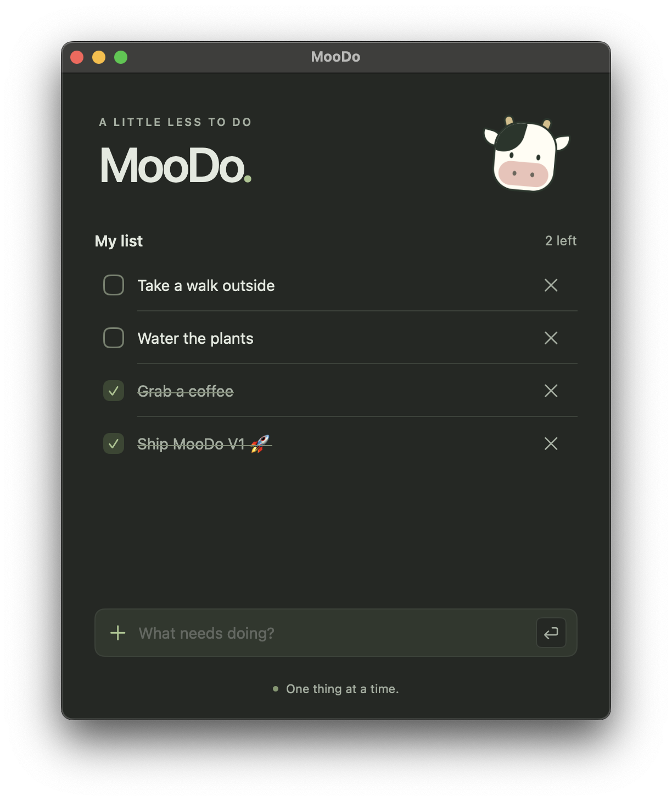

# MooDo

**A little less to do.**

MooDo is a small, native macOS to-do app for keeping track of everyday tasks.
One list, a friendly cow, and a little space to focus on the next thing.

<p align="center">
  
</p>

## What it does

- Add tasks and check them off as you go.
- Keep unfinished tasks above completed ones, in the order you added them.
- See how many tasks are left and delete tasks you no longer need.
- Save your list automatically on your Mac using SwiftData.
- Follow your Mac's light or dark appearance.

MooDo works offline and needs no account. V1 keeps things simple: a single local
list, without due dates, reminders, or cloud sync.

## Download and install

**Requires macOS 15.7 or later.** MooDo is distributed through GitHub Releases.
You don't need Xcode or an Apple Developer account to use a packaged release.

1. Open [MooDo Releases](https://github.com/CommandeurNicolas/MooDo/releases).
2. Choose the latest release and expand **Assets**.
3. Download the `MooDo-<version>-macOS-universal.pkg` installer, open it, and
   follow the installation steps. It installs **MooDo** in **Applications** and
   may ask for an administrator password.
4. Open **MooDo** from **Applications**.

If you prefer to install it yourself, download
`MooDo-<version>-macOS-universal.zip`, unzip it, and drag **MooDo.app** into
**Applications**. The universal packages contain builds for both Apple silicon
and Intel Macs.

GitHub's **Source code (zip)** and **Source code (tar.gz)** downloads contain the
project, not an installable app. If a release has no `.pkg` or app `.zip` asset
yet, use the [build instructions below](#build-from-source).

### First launch: macOS security warning

The initial GitHub builds are not signed with an Apple Developer ID or notarized
by Apple. macOS may block the installer or app because it cannot verify the
developer or check the app for malicious software. Packaging it as an installer
does not remove this warning.

If you trust the download from this repository:

1. Try opening the installer or app once, then dismiss the warning.
2. Open **System Settings → Privacy & Security**.
3. Scroll to **Security**, find the message for MooDo, and click **Open Anyway**.
4. Confirm the prompt and authenticate if asked.

You may need to do this for both the installer and the installed app. On a
managed Mac, your administrator may restrict this option. See
[Apple's instructions for opening apps safely](https://support.apple.com/en-us/102445).

## Using MooDo

- **Add a task:** type in **What needs doing?** and press **Return**, or click the
  return-arrow button.
- **Start another task:** press **Return** when the input isn't focused to focus it.
- **Leave the input:** press **Escape**.
- **Complete or reopen a task:** click its checkbox.
- **Delete a task:** click the **×** beside it. :warning:***Deletion is immediate***:warning:.

Your changes are saved locally, so your list is there when you reopen the app.

## Build from source

You need a Mac running macOS 15.7 or later, **Xcode 26.3 or later**, and Git.
The project uses SwiftUI and SwiftData, with no third-party dependencies.

1. Clone the repository:

   ```sh
   git clone https://github.com/CommandeurNicolas/MooDo.git
   cd MooDo
   open MooDo.xcodeproj
   ```

2. In Xcode, select the **MooDo** scheme and **My Mac** as the run destination.
3. Select the **MooDo** app target, then open **Signing & Capabilities**. For a
   local build without a paid membership, use **Sign to Run Locally** as the
   signing certificate. If Xcode reports a team or provisioning error, turn off
   **Automatically manage signing**, clear the existing **Team**, and select
   **Sign to Run Locally** again. This uses an ad hoc signature for your Mac.
4. Choose **Product → Run** (**⌘R**) to build and launch MooDo.

To keep the app in Applications, choose **Product → Show Build Folder in Finder**,
open **Products → Debug**, and copy **MooDo.app** into **Applications**. Quit the
running copy before opening the installed one.

## License

MooDo is available under the [MIT License](LICENSE).
